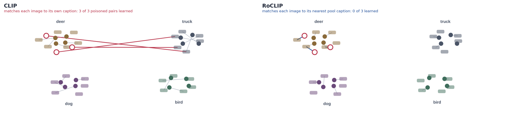

# RoCLIP: Robust Contrastive Language-Image Pretraining against Data Poisoning and Backdoor Attacks

**NeurIPS 2023** · [Wenhan Yang](https://hangeryang.github.io/), Jingdong Gao, [Baharan Mirzasoleiman](https://baharanm.github.io/) · UCLA

[Project page](https://hangeryang.github.io/RoCLIP/) · [Paper](https://arxiv.org/abs/2303.06854) · [OpenReview](https://openreview.net/forum?id=ONwL9ucoYG) · [Poster](https://nips.cc/virtual/2023/poster/71818)

<p align="center"></p>

Poisoning about one in a million image–caption pairs is enough to make CLIP learn an attacker's association. **RoCLIP** is the first defense for pre-training CLIP on such data. Instead of pulling each image toward the caption it came with, it pulls it toward its nearest neighbor in a large, constantly refreshed pool of captions. Clean images still find captions about their own content; poisoned images almost never find the attacker's caption, so the link is never learned. No clean data or clean model is needed.

| | CLIP | **RoCLIP** |
|---|---|---|
| Backdoor attack success (1M CC3M pairs) | 78% | **0%** |
| Targeted poisoning success, up to 0.5% of data poisoned | 100% | **0%** |
| Linear-probe accuracy, average over 10 datasets | — | **+5.9** |
| Training time per epoch | — | **+6%** |

## How it works

1. **Caption pool.** A first-in, first-out queue of caption embeddings, 2% of the dataset in size, refreshed with every mini-batch.
2. **Nearest-neighbor matching.** Images and captions are augmented, then each image's positive is the pool caption closest to it rather than its own caption.
3. **Every K epochs.** RoCLIP's loss is used every K-th epoch and the standard CLIP loss otherwise (K = 3 by default, K = 2 against strong attacks).

## Setup

```bash
git clone https://github.com/HangerYang/RoCLIP.git
cd RoCLIP/model
conda env create --prefix ./env -f environment.yml
conda activate ./env
python -m nltk.downloader all
```

## Data

Training and validation files are CSV/TSV files with two columns: an image path on your machine and its caption. The scripts don't download images; for CC3M or CC12M, fetch them first with `python utils/download.py --help`.

## Training

Run from `RoCLIP/model`:

```bash
python -m src.main --name roclip_cc3m \
  --train_data <train.csv> --validation_data <valid.csv> \
  --image_key <image column> --caption_key <caption column> \
  --device_ids 0 1 2 3 --distributed \
  --memory_bank --memory_bank_size 21845 \
  --RoCLIP_switch --break_epoch 3 --cross_aug
```

| Flag | Meaning |
|---|---|
| `--memory_bank`, `--memory_bank_size` | Turn on the caption pool and set its size |
| `--RoCLIP_switch`, `--break_epoch` | Alternate RoCLIP and CLIP losses; use RoCLIP every `break_epoch` epochs (K) |
| `--cross_aug` | Augment images and captions before matching |

## Evaluation

Zero-shot on ImageNet-1K:

```bash
python -m src.main --name eval_imagenet --eval_data_type ImageNet1K \
  --eval_test_data_dir data/ImageNet1K/validation/ \
  --device_id 0 --checkpoint <path/to/checkpoint.pt>
```

The test directory needs a `labels.csv` with two columns, `image` and `label`. Add `--linear_probe --eval_train_data_dir <dir>` for linear-probe evaluation.

## Follow-up

[SafeCLIP](https://github.com/HangerYang/SafeCLIP) (ICML 2024) extends this line of work to defend CLIP pre-training without any loss in zero-shot accuracy.

## Acknowledgements

This code builds on [CyCLIP](https://github.com/goel-shashank/CyCLIP), [OpenCLIP](https://github.com/mlfoundations/open_clip) and [CLIP](https://github.com/openai/CLIP).

## Citation

```bibtex
@inproceedings{yang2023robust,
  title     = {Robust Contrastive Language-Image Pretraining against Data Poisoning and Backdoor Attacks},
  author    = {Yang, Wenhan and Gao, Jingdong and Mirzasoleiman, Baharan},
  booktitle = {Thirty-seventh Conference on Neural Information Processing Systems},
  year      = {2023}
}
```
